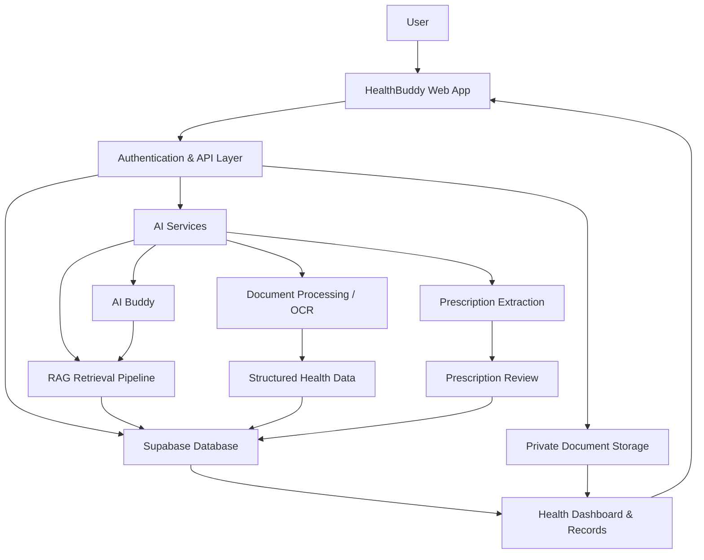
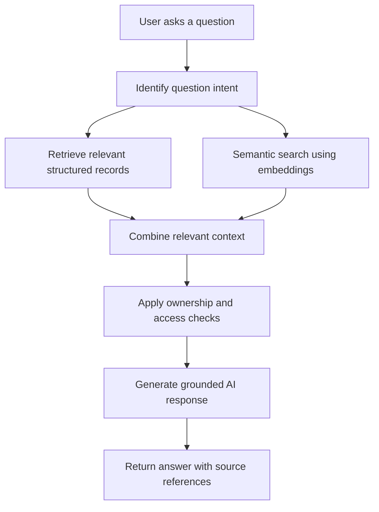

# 🩺 HealthBuddy
### Your health records. Your insights. One intelligent companion.

<p align="center">
  <strong>A smarter way to understand, organize, and manage your personal health information.</strong>
</p>

<p align="center">
  
  
  
  
</p>

---

## ✨ What is HealthBuddy?

**HealthBuddy** is an AI-powered personal healthcare management platform designed to make health information easier to understand, organize, and access.

Medical reports, prescriptions, test results, appointments, symptoms, and health measurements often end up scattered across different files and applications. Understanding how they relate to one another can be difficult.

HealthBuddy aims to bring this information together in one place and make it useful through AI-assisted document understanding and personalized health conversations.

Instead of treating every medical document as an isolated file, HealthBuddy is designed around a connected personal health history.

> **One platform. A more organized health journey.**

## 🚀 Core Features

### 🤖 1. AI Buddy — Your Personal Health Companion

An AI-powered conversational assistant designed to answer health-related questions using relevant information from your personal health records.

- Ask questions about uploaded medical reports.
- Understand medical terminology in simpler language.
- Review relevant health history during conversations.
- Ask about previously recorded measurements and symptoms.
- Get summaries of available medical information.
- Understand which records or sources informed an answer.

**The goal:** Move beyond a generic chatbot toward an assistant that understands the user's available health context.

### 📄 2. Intelligent Medical Report Analysis

Medical reports can contain complex terminology, abbreviations, measurements, and reference ranges.

HealthBuddy aims to make these documents easier to understand.

- Upload medical documents.
- Extract relevant text using OCR and document-processing tools.
- Identify important medical measurements and findings.
- Present extracted information in a structured format.
- Help users understand report terminology.
- Keep the original document available for reference.

Supported document formats are intended to include:

| Format | Support target |
|---|---|
| PDF | Medical reports and prescriptions |
| JPG / JPEG | Scanned documents and photographs |
| PNG | Digital medical documents |

### 💊 3. Prescription Intelligence

Prescriptions are more than images containing medicine names. They contain important instructions that need to be interpreted carefully.

HealthBuddy is designed to extract structured information such as:

- Doctor and clinic information
- Prescription and consultation dates
- Medicine names
- Strength and dosage
- Frequency and route of administration
- Food-related instructions
- Treatment duration
- Recommended tests
- Follow-up instructions

**Human verification is essential.**

Extracted prescription information should first appear in a review state. Users must inspect and explicitly confirm the information before it becomes part of their confirmed medication records.

### 📊 4. Personal Health Dashboard

A centralized overview of personal health information.

The dashboard is designed to bring together:

- Health measurements and trends
- Recent medical reports
- Confirmed medications
- Upcoming appointments
- Follow-up information
- Recently recorded symptoms
- Important health updates

The intention is to help users see their health information over time rather than relying on isolated readings.

### 🗂️ 5. Digital Health Records

Keep important health information organized in one place.

Planned record categories include:

- Medical reports
- Prescriptions
- Laboratory results
- Doctor visits
- Symptoms and observations
- Allergies
- Confirmed diagnoses
- Personal health notes
- Measurements and vital signs

### 🔔 6. Medication & Care Management

HealthBuddy is designed to help users organize their care routines.

Potential capabilities include:

- Confirmed medication records
- Medication schedules based on verified instructions
- Appointment management
- Follow-up tracking
- Treatment-duration tracking
- Care-related reminders

Reminder generation must respect the actual prescription instructions. For example, an as-needed medication should not automatically become a fixed daily reminder.

### 🧠 7. RAG-Powered Personal Health Knowledge

One of the central technical ideas behind HealthBuddy is **Retrieval-Augmented Generation (RAG)**.

Rather than sending an entire medical history to an AI model for every question, HealthBuddy is designed to retrieve the information relevant to the user's question.

The system combines two approaches:

**Structured retrieval**

Used when exact information matters:

- Medication names and dosage
- Measurement values
- Prescription dates
- Appointment dates
- Confirmed diagnoses
- Other structured health records

**Semantic retrieval**

Used when meaning and context matter:

- Medical report explanations
- Personal health notes
- Historical observations
- Uploaded document content
- Previous relevant health discussions

The retrieved information can then be used to generate a context-aware response.

This approach aims to improve relevance, reduce unnecessary context, and keep answers grounded in the user's available records.

---

## 🏗️ System Architecture

HealthBuddy is designed around a web application, a secure backend, persistent health records, and AI-powered processing services.



### How the RAG pipeline is intended to work



The retrieval layer should always enforce user-level authorization. A user's question must never retrieve another user's medical information.

---

## 🛠️ Technology Stack

The project uses a modern web development stack.

| Technology | Purpose |
|---|---|
| Next.js | Web application and server-side functionality |
| React | Component-based user interface |
| TypeScript | Type safety |
| Tailwind CSS | UI styling |
| Supabase | Authentication, PostgreSQL database and storage |
| PostgreSQL | Persistent health records |
| pgvector | Vector storage and semantic retrieval |
| AI provider APIs | AI-powered processing and conversations |
| OCR / document processing | Text extraction from uploaded documents |

*Specific AI providers and OCR engines depend on the project's configured integrations.*

---

## 🔐 Security & Privacy

Health information is sensitive. Privacy and security are fundamental design requirements, not optional features.

HealthBuddy is designed around the following principles:

- **Authentication:** Users should access their own accounts securely.
- **Row Level Security (RLS):** Database access should be restricted to authorized users.
- **Private storage:** Medical documents should not be publicly accessible.
- **Server-side secrets:** Privileged API keys must never be exposed in browser code.
- **Data ownership:** Every health record must be associated with its owner.
- **Controlled AI context:** Only relevant, authorized health information should be retrieved.
- **Explicit confirmation:** AI-extracted prescription information must not become confirmed without user approval.

HealthBuddy is an assistive health-information platform. It is not a replacement for a qualified medical professional.

---

## 🧭 Application Modules

| Module | Responsibility |
|---|---|
| Home | Health overview and dashboard |
| Records | Medical documents and health history |
| AI Buddy | Context-aware health conversations |
| Care | Medication, appointments and follow-ups |
| Profile | Personal information and health preferences |

---

## ⚙️ Getting Started

### Prerequisites

Make sure you have the following installed:

- Node.js
- npm
- Git
- A Supabase project
- An AI provider API key for AI functionality

### 1. Clone the repository

```bash
git clone https://github.com/hasbulkhan45/healthbuddy.git
cd healthbuddy
```

### 2. Install dependencies

```bash
npm install
```

### 3. Configure environment variables

Create a `.env.local` file in the project root.

Use the variable names expected by the current application code. A typical configuration may look like:

```env
NEXT_PUBLIC_SUPABASE_URL=your_supabase_project_url
NEXT_PUBLIC_SUPABASE_ANON_KEY=your_supabase_publishable_key

SUPABASE_SECRET_KEY=your_server_only_secret_key

AI_API_KEY=your_ai_provider_api_key
```

> **Important:** These are illustrative variable names. Check the application's actual environment-variable references before configuring your deployment. Never commit real API keys or privileged Supabase secrets to GitHub. Never expose secret keys through `NEXT_PUBLIC_` variables.

### 4. Run database migrations

Apply the SQL migrations in the repository to your Supabase project.

Make sure that required tables, relationships, indexes, storage policies, and Row Level Security policies are configured.

### 5. Start the development server

```bash
npm run dev
```

Open:

```text
http://localhost:3000
```

### 6. Production build

```bash
npm run build
npm start
```

---

## 📁 Project Structure

The project is organized around application routes, reusable components, backend services, and database functionality.

```text
healthbuddy/
│
├── app/                     # Next.js application routes
│   ├── (main)/               # Main authenticated application
│   └── api/                  # Backend API routes
│
├── src/
│   ├── lib/                  # Shared libraries and integrations
│   │   ├── ai/               # AI-related utilities
│   │   └── supabase/         # Supabase clients and configuration
│   │
│   └── services/             # Application service logic
│
├── components/               # Reusable UI components
├── services/                 # Feature-specific service modules
├── supabase/                 # Database migrations and configuration
├── public/                   # Static assets
│
├── package.json
├── tsconfig.json
└── README.md
```

*This is a conceptual overview. Actual folders and filenames may vary as the project evolves.*

---

## 🗺️ Development Roadmap

HealthBuddy is an evolving project. The following roadmap describes the intended development direction, not a claim that every feature is already complete.

### Foundation
- [ ] Complete authentication and user profiles
- [ ] Verify database schema and migrations
- [ ] Enforce Row Level Security
- [ ] Secure private document storage
- [ ] Validate application build and deployment

### Medical Records
- [ ] Complete document upload workflow
- [ ] Integrate real OCR processing
- [ ] Structure extracted report information
- [ ] Persist health records reliably
- [ ] Support manual health data entry

### Prescription Intelligence
- [ ] Complete prescription extraction
- [ ] Build user review and confirmation workflow
- [ ] Persist confirmed medicine records
- [ ] Add safe medication and follow-up management

### AI & RAG
- [ ] Implement document chunking and embeddings
- [ ] Integrate PostgreSQL vector search
- [ ] Combine structured and semantic retrieval
- [ ] Add source-aware AI responses
- [ ] Enforce ownership-aware retrieval
- [ ] Evaluate accuracy and hallucination handling

### User Experience
- [ ] Complete dashboard and health trends
- [ ] Improve records management
- [ ] Complete AI Buddy experience
- [ ] Implement care reminders
- [ ] Improve mobile responsiveness
- [ ] Add loading, error and empty states

---

## ⚠️ Medical Disclaimer

HealthBuddy is intended to help users organize and understand their personal health information.

It does not provide a medical diagnosis, replace professional medical advice, or prescribe treatment.

AI-generated explanations may be incomplete or incorrect. Always verify medical information with a qualified healthcare professional.

Never start, stop, change, or substitute medication based solely on an AI-generated response.

---

## 🤝 Contributing

Contributions, suggestions, bug reports, and ideas are welcome.

If you want to contribute:

1. Fork the repository.
2. Create a feature branch.
3. Make your changes.
4. Test your implementation.
5. Submit a pull request with a clear explanation.

```bash
git checkout -b feature/your-feature-name
git add .
git commit -m "feat: describe your change"
git push origin feature/your-feature-name
```

Please avoid including real patient data, medical documents, API keys, or other sensitive information in issues and pull requests.

---

## 🎯 Project Vision

HealthBuddy is built around a simple idea:

**Your health history should be connected, understandable, and accessible when you need it.**

By combining personal health records, document intelligence, structured data, and retrieval-augmented AI, HealthBuddy aims to make managing personal healthcare information a more organized and informed experience.

---

<p align="center">
  <strong>Built with ❤️ for a healthier, more informed future.</strong>
  <br />
  <a href="https://github.com/hasbulkhan45/healthbuddy">GitHub Repository</a>
</p>
